# Quits

Split the bill at the table. One person pays; everyone else taps what they had and pays them back from their own wallet, on Stellar. Or play for it: a round of hidden coins, sealed and judged by a Soroban contract, decides who pays for everyone.

**Live:** https://quits.aircade.xyz, on Stellar mainnet, the round included

**HackMeridian 2026, Genesis path (Stellar Unlocked + Stellar Composed).** Quits arrived at the hackathon as an MVP (everything up to the `pre-hackmeridian` branch); the round, *Who pays?*, was built during the event. [What was built when](#built-when).

## The problem

At a group dinner one person pays, and then the hard part starts: working out who had what, collecting wallet addresses, chasing people for days. Crypto makes paying easy, but not splitting.

## How Quits works

[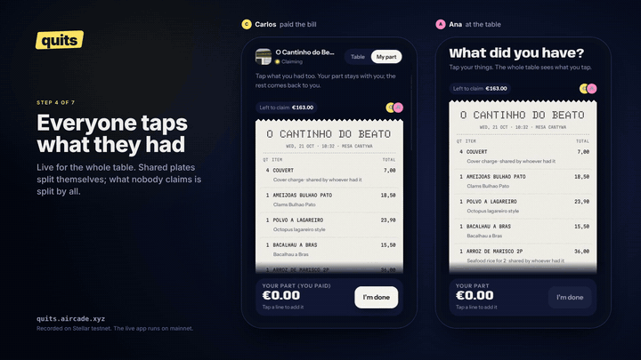](https://quits.aircade.xyz/demo.mp4)

**[Watch the demo (90 s)](https://quits.aircade.xyz/demo.mp4)** ([file in this repo](src/web/static/demo.mp4)): Carlos pays at a tasca, Ana scans the QR, the receipt is read by AI, everyone taps what they had, Ana pays back in USDC on Stellar, and the night stays with its photos. Recorded on Stellar testnet; the live app runs on mainnet.

1. The host opens a table and snaps the place. The photo becomes the cover of the night.
2. Friends scan the QR on the table. It opens in the browser: no app, and no account needed.
3. The host snaps the receipt. Claude reads every line.
4. Everyone taps what they had on a shared, live receipt. Shared plates split themselves, what nobody claimed is split by everyone, and the tip goes on top.
5. Each guest pays the host back in USDC from their own Stellar wallet, or marks cash for the host to confirm.
6. Quits. The night stays with photos, who was there and what each paid. Signing in with Google keeps it in your profile on any phone.

## Who pays? The round (built at HackMeridian)

[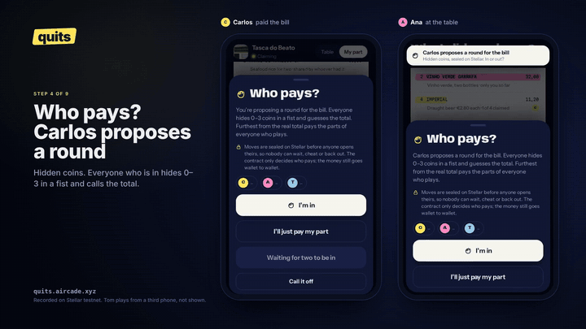](https://quits.aircade.xyz/demo-round.mp4)

**[Watch the round (105 s)](https://quits.aircade.xyz/demo-round.mp4)** ([file in this repo](src/web/static/demo-round.mp4)): Carlos proposes a round, Ana seals her move, the moves open, the contract names who pays, and Ana pays Carlos back for everyone. Recorded on Stellar testnet with two phones and a third player on the API.

Before paying back, the host can propose a round for the bill. It is *los chinos*, the Spanish bar game, in one simultaneous round:

1. Everyone who is in hides 0–3 coins in a fist and calls the total on the table.
2. Each move is **sealed**: the phone hashes it with a random salt and signs the hash with a key that only that phone has. The signed seal goes to the `whopays` contract on Stellar. Nobody, not even Quits, can see a move before everyone has sealed.
3. Once every seal is on chain, phones **open** their moves and the contract checks each one against its seal. The player furthest from the real total pays the parts of everyone who played; ties are drawn from the salts, which were all fixed before anything was opened. Whoever does not open in time loses: that is what keeps the round honest once the others' moves are on the table.
4. Quits reads the verdict and moves the players' parts to the loser. The loser pays the host as usual; the others are off the hook. The round, with its moves and the settling transaction, stays with the night.

Playing is optional (whoever stays out pays their own part), nothing is wagered and the contract never holds funds: it only decides who pays a bill the group already owes. The money still goes wallet to wallet.

| | | | |
|:-:|:-:|:-:|:-:|
| 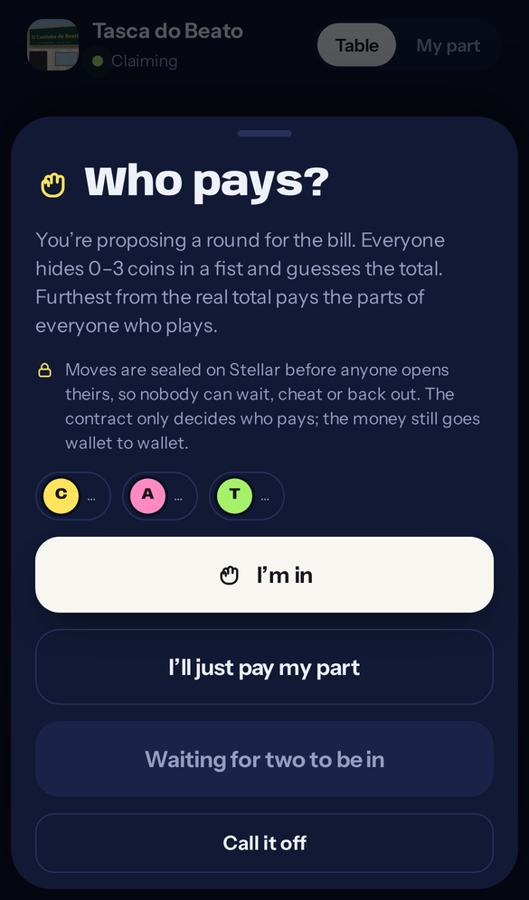<br>**Who pays?**<br><sub>The host proposes; everyone answers</sub> | 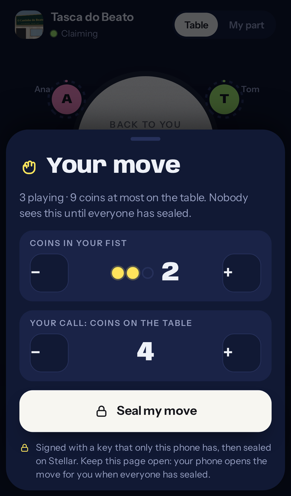<br>**Your move**<br><sub>Coins in your fist, your call on the total</sub> | 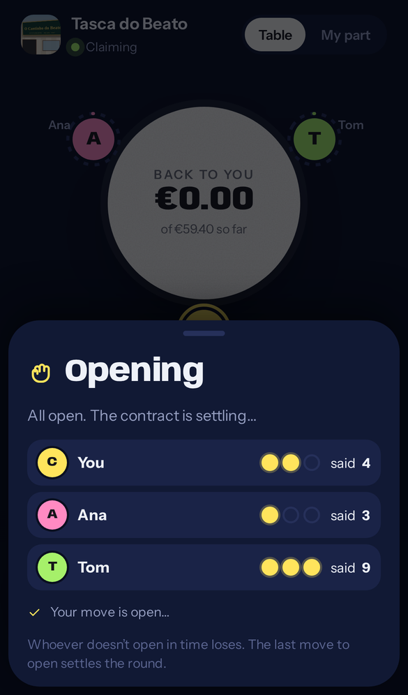<br>**Opening**<br><sub>Seals and moves land on Stellar</sub> | 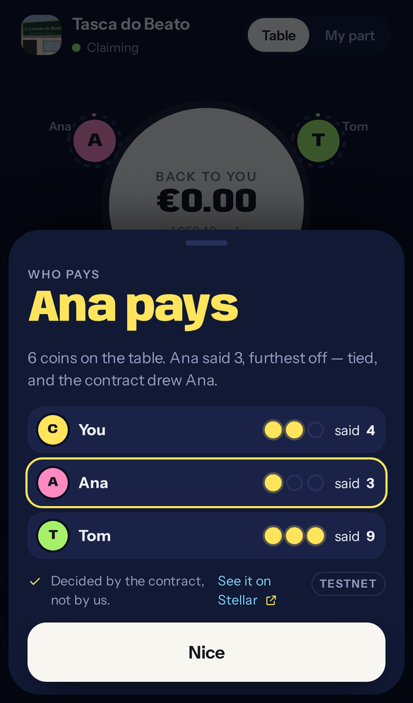<br>**The verdict**<br><sub>Decided by the contract, with the transaction</sub> |

**Why on chain:** with sealed moves a player cannot wait to see what the others played, cannot change their move afterwards, and cannot quietly back out when they see they have lost (silence loses). A server could do the first two only by being trusted; a contract everyone can read does all three without trust, and the verdict comes with a transaction anyone can check. A round costs about 0.1 XLM in fees in total.

### The flow, screen by screen

| | | | |
|:-:|:-:|:-:|:-:|
| 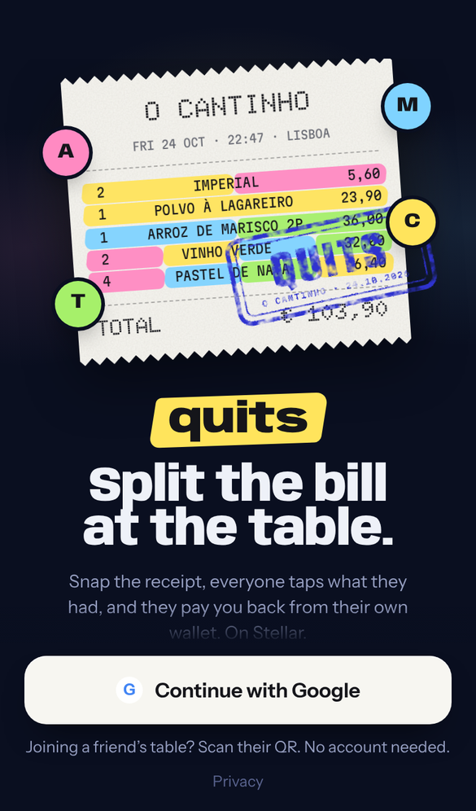<br>**Welcome**<br><sub>Sign in with Google to keep your nights</sub> | 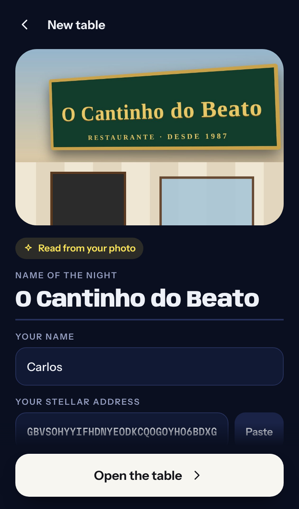<br>**Open a table**<br><sub>A photo of the place; Quits reads the name</sub> | 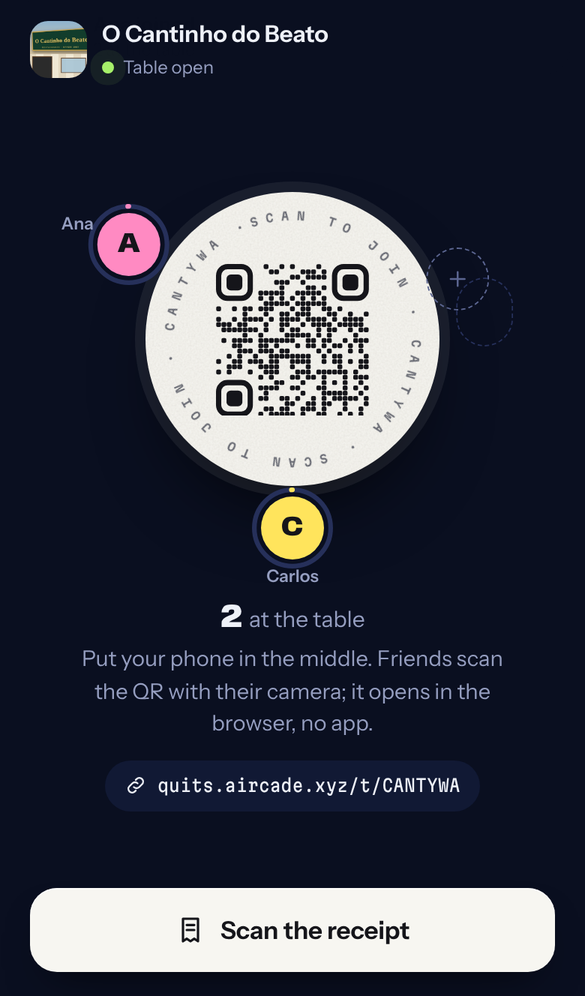<br>**The table**<br><sub>Friends scan the QR; seats fill up live</sub> | 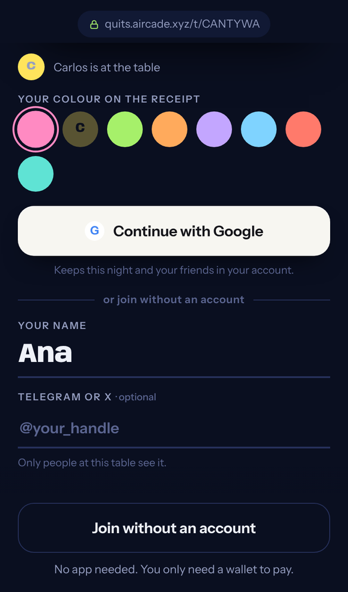<br>**Join**<br><sub>In the browser, with Google or without an account</sub> |
| 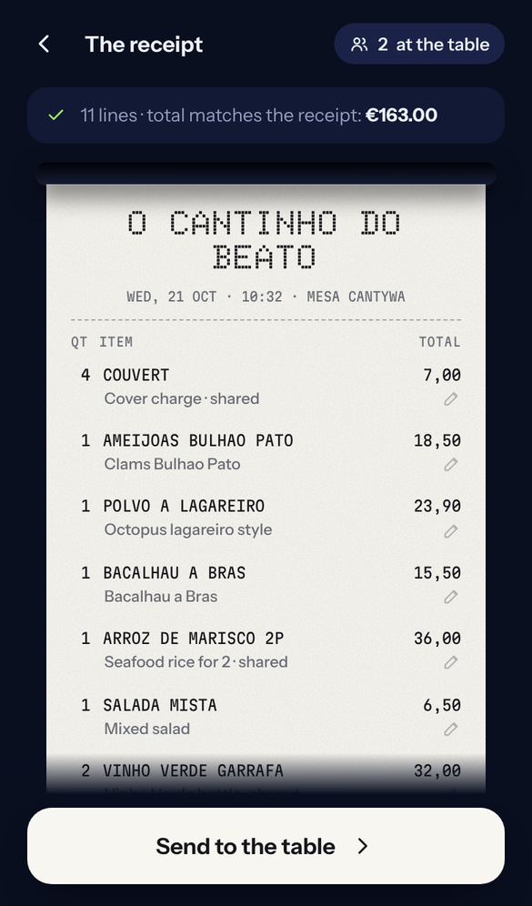<br>**The receipt**<br><sub>AI reads every line; the total is checked</sub> | 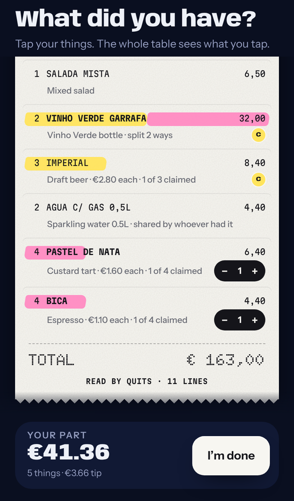<br>**Tap what you had**<br><sub>Everyone sees it live; shared plates split</sub> | 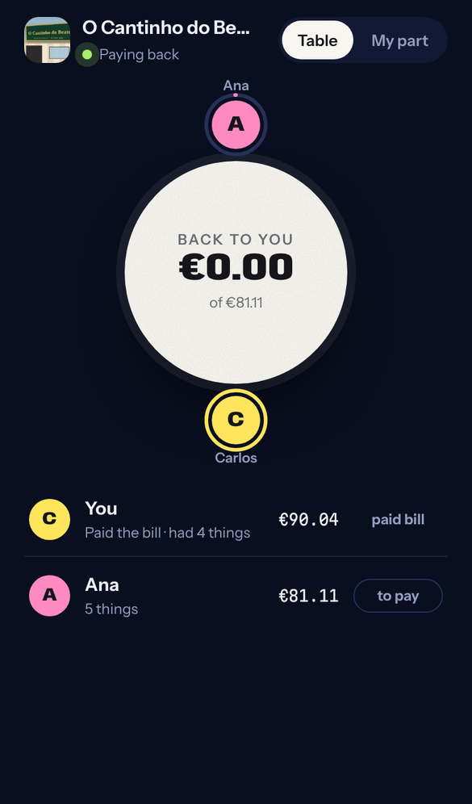<br>**The host's view**<br><sub>Who owes what and what is already back</sub> | 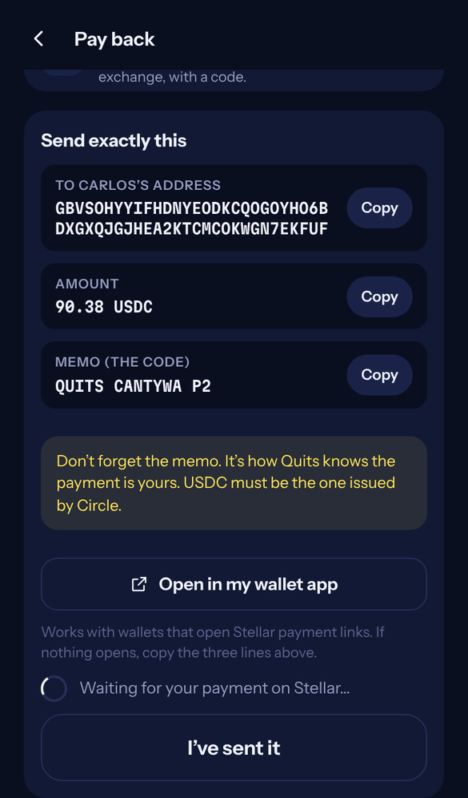<br>**Pay back**<br><sub>One tap from a wallet app, or by hand with a memo</sub> |
| 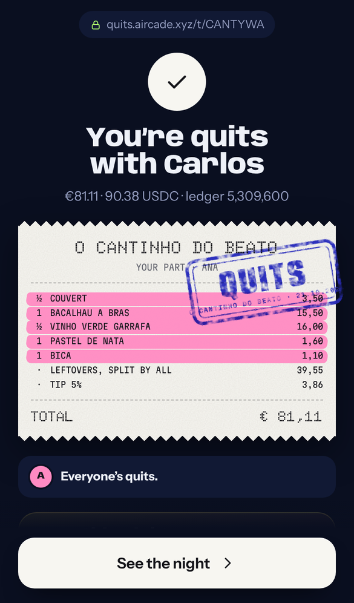<br>**Paid**<br><sub>Seen on Stellar; your part, stamped</sub> | 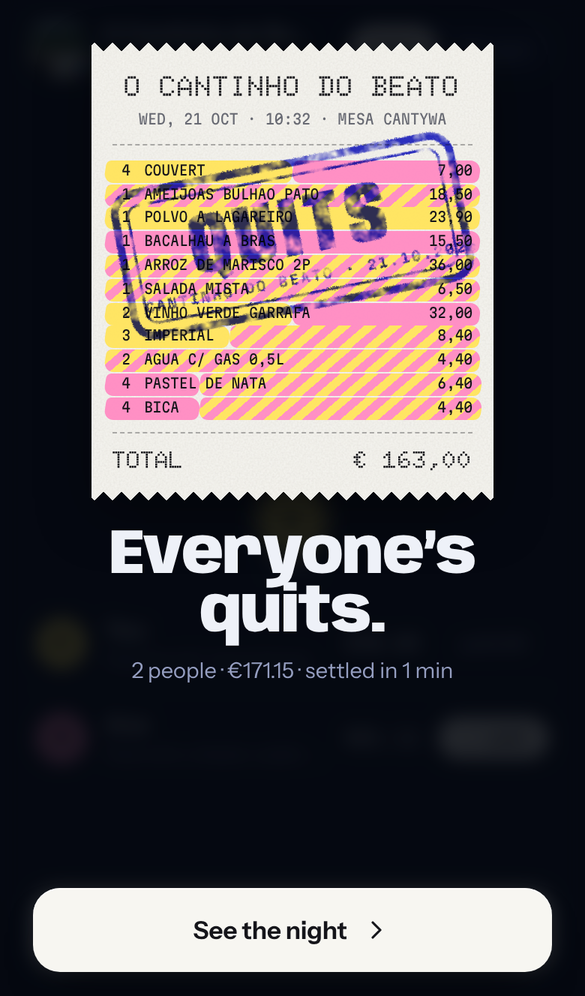<br>**Everyone’s quits**<br><sub>The moment the last share lands</sub> | 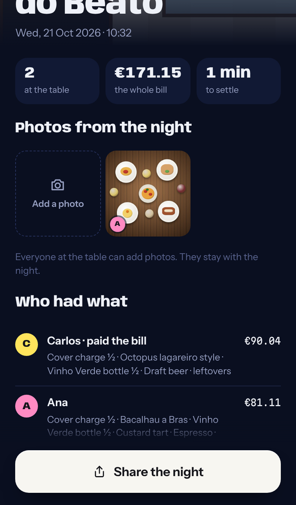<br>**The night stays**<br><sub>Photos, who was there, who had what</sub> | 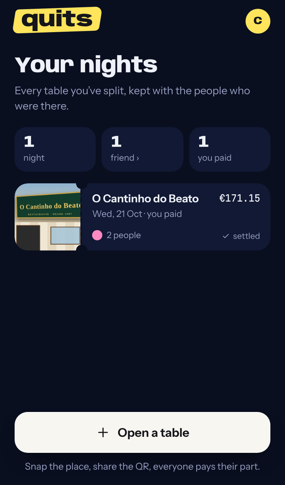<br>**Your nights**<br><sub>Every table you split, with the people who were there</sub> |

## How it uses Stellar

- **Money moves wallet to wallet.** Guests pay the host directly in USDC (Circle) on Stellar. Quits never holds funds; it only reads the ledger.
  - USDC issuer, mainnet: `GA5ZSEJYB37JRC5AVCIA5MOP4RHTM335X2KGX3IHOJAPP5RE34K4KZVN`
  - USDC issuer, testnet: `GBBD47IF6LWK7P7MDEVSCWR7DPUWV3NY3DTQEVFL4NAT4AQH3ZLLFLA5`
- **Every share has a memo**, `QUITS <TABLE> <SEAT>`. Quits confirms a payment either from the transaction hash the wallet returns, or by watching the host's payments on Horizon for that memo (for payments sent by hand from any wallet or exchange).
- **Before a table opens**, Quits checks on Horizon that the host's account exists and can receive USDC (has the trustline), so money can't bounce.
- **Euro bills** are converted at the mid price of the EURC/USDC order book on Stellar mainnet.
- **Wallets**:
  - desktop: [Stellar Wallets Kit](https://github.com/Creit-Tech/Stellar-Wallets-Kit) (Freighter, xBull, LOBSTR, Albedo, Rabet, Hana);
  - phone: WalletConnect (Reown) for Freighter, LOBSTR and Scopuly;
  - anything else (Decaf, an exchange…): send it yourself with address, amount and memo, with a SEP-7 QR on desktop.
- **The round** is judged by a Soroban contract, [`contracts/whopays`](contracts/README.md):
  - mainnet: `CAYHWHSNRG6R436BHAHI4Y6IXVPWS3ZTEUBSGZ7ORHSYAK2ORE5UH5UA` ([stellar.expert](https://stellar.expert/explorer/public/contract/CAYHWHSNRG6R436BHAHI4Y6IXVPWS3ZTEUBSGZ7ORHSYAK2ORE5UH5UA)), the one the live app uses; testnet: `CAQOQKI4GOX36MPWTYK27TNJB32I5VRLEHGADOUHOFUBMISUWIUHH5J2` ([stellar.expert](https://stellar.expert/explorer/testnet/contract/CAQOQKI4GOX36MPWTYK27TNJB32I5VRLEHGADOUHOFUBMISUWIUHH5J2)); the same 16 KB of Wasm (`b06ead9f…`), `soroban-sdk` 29;
  - `create`, `commit` / `commit_many`, `close`, `reveal` / `reveal_many`, `settle`, `game`, `commitment`;
  - players are Ed25519 public keys made in the browser (no Stellar account, no wallet); a seal is a 64-byte signature checked with the host's `ed25519_verify`; a move is `SHA-256("QUITS/c" ‖ game ‖ player ‖ coins ‖ guess ‖ salt)`, checked on reveal with the host's `sha256`;
  - one funded account (the contract's admin) relays everybody's moves and pays the fees, so a player never signs a Stellar transaction; anyone could relay a move, since each one carries its own signature;
  - a round lives in temporary storage for an hour; its transactions and events are the record. On mainnet a three-player round is five transactions and 0.007 XLM in fees.
- **Next:** pay-ins from Base and Solana through Circle CCTP, landing as USDC in the host's Stellar account.

## Architecture

```
browser (vanilla JS + GSAP, esbuild)          Cloudflare Worker
  src/web/main.js   ──── HTTPS / WebSocket ──▶  src/worker/index.js   API + static app
  src/web/wallet.js (loaded only to pay)         ├─ TableDO   one Durable Object per table: live state,
                                                 │            seats, photos (SQLite), payment watcher
  src/shared/logic.js  ◀── same split logic ──▶  ├─ UserDO    one per Google account: profile, nights
  src/shared/game.js   ◀── same hashing ──────▶  ├─ LimiterDO daily caps (AI calls, sign-ins, tries)
                                                 ├─ ChainDO   one for the app: relays the round's moves
                                                 │            to Stellar, one transaction at a time
                                                 ├─ game.js   the round inside a table: invite, seals,
                                                 │            openings, verdict (checks signatures/hashes)
                                                 ├─ chain.js  builds and sends the contract calls (RPC)
                                                 ├─ ai.js     Claude Haiku reads receipts and venue signs
                                                 └─ stellar.js Horizon: verify payments, trustlines, rates
contracts/whopays (Rust, soroban-sdk 29)         the contract that judges the round; tests, deploy script
```

- Live tables: WebSockets with Durable Object hibernation. What one person taps, everyone sees at once.
- Receipt reading: Anthropic Messages API with a forced tool call for structured output. About $0.0007 per receipt.
- Accounts: Sign in with Google (ID tokens checked against Google's keys in the Worker) and HMAC-signed sessions. Optional for guests.
- Opening a table can require an invite code (`INVITE_CODES`); joining never does.

## Run it locally

Requires Node 20+.

```
npm install
cp .dev.vars.example .dev.vars   # fill in the values
npm run dev                      # builds the app and serves it on http://localhost:8787
```

| Variable | Where | What |
|---|---|---|
| `ANTHROPIC_API_KEY` | secret | Reads receipts and venue photos (`AI_MOCK=1` uses a sample receipt instead) |
| `SESSION_SECRET` | secret | Signs sign-in sessions |
| `INVITE_CODES` | secret, optional | Comma-separated codes needed to open a table |
| `AUTH_TEST` | `.dev.vars` only | `1` shows a test sign-in button instead of Google. Never in production |
| `NETWORK` | `wrangler.jsonc` | `testnet` or `public` |
| `GOOGLE_CLIENT_ID` | `wrangler.jsonc` | Google sign-in (public). Without it the app runs without accounts |
| `WC_PROJECT_ID` | `wrangler.jsonc` | Reown / WalletConnect project (public) |
| `CLAUDE_MODEL`, `AI_DAILY_MAX` | `wrangler.jsonc` | Model and daily cap on AI calls |
| `GAME_SECRET` | secret | Stellar secret key of the account that relays the round's moves (the contract's admin). Without it the round is off |
| `GAME_CONTRACT`, `GAME_NETWORK` | `wrangler.jsonc` | The `whopays` contract and its network (`testnet` or `public`). Production runs the mainnet contract; `.dev.vars` points local development at the testnet one |

## Deploy

```
npx wrangler secret put ANTHROPIC_API_KEY
npx wrangler secret put SESSION_SECRET
npx wrangler secret put INVITE_CODES
npx wrangler secret put GAME_SECRET
npm run deploy
```

The contract is built and deployed from `contracts/` (see [its README](contracts/README.md)).

## Demo

1. Open https://quits.aircade.xyz on your phone and continue with Google. Opening a table needs an invite code; judges get one from the team.
2. Snap the place, then the receipt.
3. Scan the table's QR with a second phone and join (with Google or without an account).
4. Tap what you had. The host taps **Who pays? Play a round**; everyone who is in picks their coins and their call and seals the move.
5. When the moves open, the contract names who pays. That person pays from a Stellar wallet, or sends it by hand with the memo, or marks cash; the others are off the hook.

## Tests

They use Playwright (`npm i -D playwright && npx playwright install chromium`) and testnet accounts made by `test/accounts.mjs`.

- `test/ui-flow.mjs`: the whole night in real browsers. Three phones, invite code, receipt read by the real model, cash confirmed by the host, a real testnet USDC payment detected by memo, the shared night, and a fourth "new phone" where a guest signs in and finds her night.
- `test/api-flow.mjs`: the same through the API, with both payment paths.
- `test/auth-unit.mjs`: Google token checks (valid, wrong audience, expired, forged) and sessions.
- `test/wc-smoke.mjs`: the phone wallet picker (WalletConnect) opens with Stellar wallets only.
- `test/game-ui.mjs`: a round in three real browsers, from the host's proposal to the loser paying, against the contract on testnet.
- `test/stale.mjs`: a page left open across a deploy reloads itself when it comes back, and a lazy chunk that vanished mid-form becomes a message instead of a broken button.
- `test/game-flow.mjs`: the round through the API: forged seals and wrong openings refused, the verdict mirrored, the parts moved to the loser.
- `contracts/whopays`: `cargo test` runs 10 tests of the contract's rules; `contracts/scripts/whopays.mjs` plays rounds on testnet or, with `NETWORK=public`, on mainnet (`round`, `silent`, `forged`).

## On-chain proof

- A payment made through Quits on testnet: [`6e9be7ac…09cc0`](https://stellar.expert/explorer/testnet/tx/6e9be7ac56fd4bbff9bbe362b54acb701c8edf3cc1505cfd8df225f4a6409cc0) (70.02 USDC, memo `QUITS CANTFYY P2`).
- A round of *Who pays?* on **mainnet**, three players, 25 Oct 2026, 0.007 XLM in fees: [create](https://stellar.expert/explorer/public/tx/e24977cc0a8066f4231077e7c8dd4c1844b9caed05c3e4b75af97698325ae317) → [one seal](https://stellar.expert/explorer/public/tx/dfdd48140d7a55b85c04e4716d838c5e7ed55a3e79aae973408ede995c573ea4) → [two seals in one transaction](https://stellar.expert/explorer/public/tx/6d2996e59aba5ba83b42c6a186966e97567e90d122e223381b2da91e5ff24355) → [one opening](https://stellar.expert/explorer/public/tx/b1647a27123d18a35c99258b77f7a16b44a63be320297fabb24267ef4c8a9903) → [the last two openings settle it](https://stellar.expert/explorer/public/tx/857d614bc38fdab212a132ce137139515e0d534ebd0c67aaf9f7e511ee19c93b): P1 pays, 2 coins on the table, furthest guess, decided by lot. The contract's [upload](https://stellar.expert/explorer/public/tx/96927bb5b76a4e068d1bef90340be39b84c077f28308ecd443ddff9be00d6fb0) and [creation](https://stellar.expert/explorer/public/tx/d5080f92548f09d196f7bdc86d32ae22e791086b22b3536c14adb2e01d83c2a1). All in [`contracts/deployments/public.json`](contracts/deployments/public.json).
- The same round on testnet, three players, 25 Oct 2026: [create](https://stellar.expert/explorer/testnet/tx/afdb538dfac6c4c20c7a19a2ce3f71c4ee71f1d1abb6558a4d06871b6fa44b64) → [one seal](https://stellar.expert/explorer/testnet/tx/33f5fe22ccc05e069539a34538e52c38ce246fa0c0250a629d7e68d5472eb96a) → [two seals in one transaction](https://stellar.expert/explorer/testnet/tx/f0edb76207e038fa13c311380b9ddcffaed53c007326fc4bcdad4757c54dcd25) → [one opening](https://stellar.expert/explorer/testnet/tx/634fcc4a3afcc29be713c816cfcb6684e722704ed86d7e123ba398d1da0b8ced) → [the last two openings settle it](https://stellar.expert/explorer/testnet/tx/64d5e589f3a0fc00d38c75353ddc3b2dd2021b799f8be843c4210bb5385ffd5c): P3 pays, 4 coins on the table. A round where one player never opens, [settled by timeout](https://stellar.expert/explorer/testnet/tx/44a71c1874f427e351cb70a31c38b75c4b3d4387e50aba9406df5bc3f831c3c1). All in [`contracts/deployments/testnet.json`](contracts/deployments/testnet.json).

## Built with AI

Quits is built by a solo founder, Carlos de la Figuera. The code is written by Claude (Anthropic), as declared in the HackMeridian submission.

## Built when

<a name="built-when"></a>

| | |
|---|---|
| **Before HackMeridian** (the `pre-hackmeridian` branch, last commit `5efdcad`, 21 Oct) | The whole bill-splitting app: tables, QR, AI-read receipts, live claiming, wallet and memo payments on mainnet, Google accounts, nights with photos. |
| **During HackMeridian** (25–26 Oct, every commit after `5efdcad` on `main`) | *Who pays?*: the `whopays` contract and its tests, its deployments on testnet and mainnet, the relay (ChainDO, chain.js, game.js), the round inside the table and its settlement, the phone screens, the two tests of the round, this README. |

Everything was built in the open on GitHub; the commit log is the timeline.
